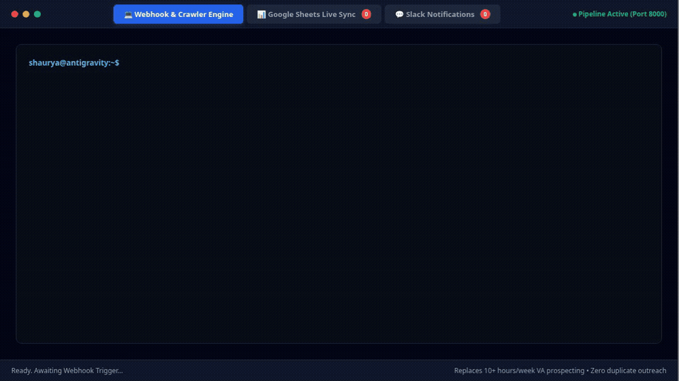
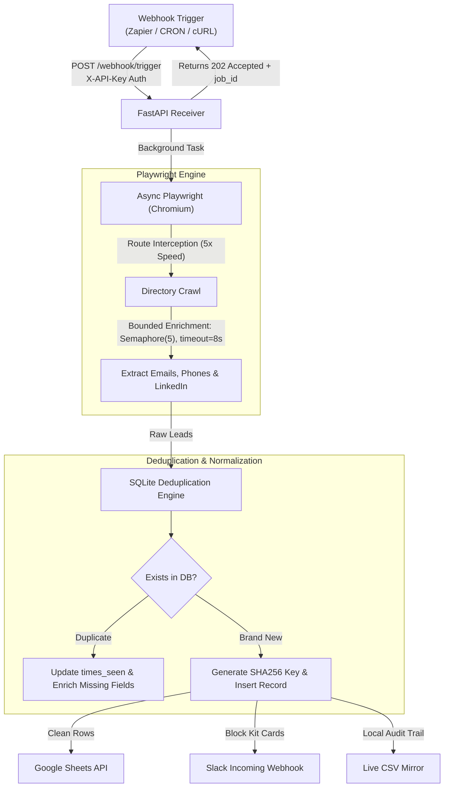

# 🏢 LeadPulse: Autonomous B2B Real Estate Lead Pipeline

[](https://www.python.org/)
[](https://playwright.dev/)
[](https://fastapi.tiangolo.com/)
[](https://www.docker.com/)
[](LICENSE)
[](assets/demo.mp4)

An enterprise-ready, webhook-triggered scraping, deduplication, and synchronization pipeline built with **Python**, **Async Playwright**, **FastAPI**, **Google Sheets API**, **Slack Webhooks**, and **Docker**.

---

## 📺 Live End-to-End Walkthrough



<p align="center">
  <em>(1) Webhook Trigger (HTTP 202 Accepted) &rarr; (2) Live Async Playwright Crawling &amp; Deduplication &rarr; (3) Clean Rows Synced to Google Sheets &rarr; (4) Interactive Slack Alerts</em>
</p>

<details>
<summary>▶️ <b>Click here to view / download high-definition MP4 recording</b></summary>

The raw 60fps MP4 recording is available directly in the repository: [`assets/demo.mp4`](assets/demo.mp4).

</details>

```
[Webhook Trigger: Zapier/cURL] 
         ↓ (HTTP 202 Accepted + job_id)
[FastAPI Background Worker] 
         ↓ (Async Playwright Chromium + Asset Interception)
[Live Commercial Directory: Austin, TX] 
         ↓ (Bounded Concurrent Enrichment: asyncio.Semaphore(5), timeout=8s)
[SQLite Deduplication Engine: Canonical Hashing] 
         ↓ (Filters duplicates & enriches missing fields)
[Multi-Channel Dispatcher] 
    ├── Google Sheets API (Styled batch append + local CSV mirror)
    └── Slack Webhook (Block Kit cards with contact info & action buttons)
```

---

## 🎯 The High-Pain Target: Commercial Real Estate Agency Discovery

### The Commercial Reality
Replaces **10+ hours/week of manual VA prospecting** and eliminates duplicate CRM outreach.

In B2B lead generation, raw scraped directory records are notoriously messy and counter-productive if unvetted:
1. **Duplicate Waste & Burned Reputation:** The same commercial brokerage is often listed 3–5 times across categories, sub-offices, or branches with subtle spelling variants (`"Keller Williams Commercial"` vs `"KW Commercial Austin Downtown"`). Unchecked, SDRs double-contact the same broker and destroy sender domain reputation.
2. **Hidden Direct Contacts:** Contact emails and broker LinkedIn URLs are rarely placed on the directory index card; scrapers must visit the agency's website, follow contact routes, and extract `mailto:` tags.
3. **Fragile Crawling:** Visiting agency websites sequentially stalls if one dead agency site hangs for 30 seconds.

### What LeadPulse Solves
LeadPulse automates this entire pipeline reliably:
* **Webhook-Triggered Async Playwright:** Receives a webhook trigger (from Zapier, Make, CRON, or internal CRM) and immediately returns **`HTTP 202 Accepted`** while spinning up headless Chromium in the background. Uses **asset route-blocking** (blocking images, fonts, and stylesheets for a 5x speedup).
* **Bounded Concurrent Enrichment:** Uses `asyncio.Semaphore(5)` with a strict **`timeout=8000` (8s)** per sub-page visit. If an agency's website is dead or slow, it times out in 8 seconds and the other 4 concurrent pages continue without stalling the batch.
* **Intelligent Multi-Factor Deduplication:** Normalizes canonical domains, cleans phone numbers to standard formats (`(XXX) XXX-XXXX ext XX`), strips corporate noise suffixes ("LLC", "Inc", "Group"), and maintains a persistent SQLite WAL database. Duplicates are filtered out, and existing records are enriched with new contact data.
* **Google Sheets API:** Formats and batch-appends clean rows directly to Google Sheets with styled headers, plus writes an instant local live mirror CSV.
* **Slack Webhooks:** Dispatches rich Slack **Block Kit** cards with company details, phone, email, ratings, and clickable website/LinkedIn buttons.
* **Production Webhook Security:** Protected by an `X-API-Key` header check to prevent unauthorized callers from triggering resource-heavy Chromium instances on public VPS deployments.

---

## 🏗️ Architecture



---

## 📂 Project Structure

```
leadpulse-pipeline/
├── app/
│   ├── __init__.py
│   ├── config.py                 # Pydantic Settings & environment loader
│   ├── models.py                 # Pydantic schemas (Lead, Job, Stats, Webhook)
│   ├── deduper.py                # SQLite persistent deduplication engine
│   ├── scraper.py                # Async Playwright crawler & bounded enrichment
│   ├── mock_server.py            # Local mock directory sandbox (used for pytest/CI)
│   ├── main.py                   # FastAPI application & webhook endpoints
│   └── integrations/
│       ├── __init__.py
│       ├── google_sheets.py      # Google Sheets API client + local CSV mirror
│       └── slack.py              # Slack Webhook Block Kit notification dispatcher
├── data/                         # Persistent database, CSV mirror, and logs
├── scripts/
│   ├── run_demo.py               # Live demo against public real estate directory
│   └── trigger_webhook.sh        # cURL webhook testing script
├── tests/
│   ├── __init__.py
│   ├── conftest.py               # Isolated test database fixture
│   ├── test_deduper.py           # Deduplication & normalization unit tests
│   ├── test_api.py               # FastAPI endpoints & webhook tests
│   ├── test_edge_cases.py        # Comprehensive edge-case & auth tests
│   └── test_scraper.py           # Playwright scraper & DOM extraction tests
├── Dockerfile                    # Production Playwright container
├── docker-compose.yml            # Container orchestration with volume mounts
├── requirements.txt              # Production Python dependencies
├── .env.example                  # Environment configuration template
└── README.md                     # Documentation
```

---

## 🚀 Quickstart

### 1. Local Setup

```bash
# Clone the repository
git clone https://github.com/ShauryaAttreya37/leadpulse-pipeline.git && cd leadpulse-pipeline

# Create and activate virtual environment
python3 -m venv .venv
source .venv/bin/activate

# Install dependencies and Playwright Chromium
pip install -r requirements.txt
playwright install chromium
```

### 2. Run the Live Demo

Run the automated pipeline demonstration. By default, this runs against a **real, public commercial real estate directory** (Central Texas Real Estate Council corporate member registry), scrapes real commercial brokerages in Austin, TX, enriches them with `asyncio.Semaphore(5)` concurrency, dedupes them, and pushes clean leads to Google Sheets and Slack:

```bash
python scripts/run_demo.py
```

*(Note: Pass `--mock` if you are working completely offline; `mock_server.py` is reserved for automated CI/pytest runs).*

**Actual Terminal Output (Real Live Directory & Real Domains):**
```
================================================================================
 🚀 LeadPulse: Autonomous Real Estate Lead Scraping & Deduplication Pipeline
================================================================================
Target:  Commercial Real Estate Agencies & Brokerages in Austin, TX
Source:  Public Commercial Real Estate Registry (https://www.reca.org/corporate--elite-member-companies.html)
Engine:  Async Playwright (Chromium) + Asset Interception + Semaphore(5) Enrichment
Storage: SQLite with Canonical Multi-Factor Hashing (WAL Mode)
Sinks:   Google Sheets API + Slack Block Kit Webhook
--------------------------------------------------------------------------------

[Step 1/5] Launching Async Playwright Browser...
  ✓ Browser crawl & bounded enrichment finished in 15.19s
  ✓ Discovered 179 raw commercial brokerages from live directory

[Step 2/5] Running Multi-Factor Deduplication & Normalization Engine...
  [+] NEW LEAD: Adolfson & Peterson Construction    | Domain: a-p.com
  [+] NEW LEAD: AGILE INTERIORS                     | Domain: agileinteriors.com
  [+] NEW LEAD: Allen Boone Humphries Robinson LLP  | Domain: abhr.com
  [+] NEW LEAD: Alterman Inc.                       | Domain: goalterman.com
  [+] NEW LEAD: American Bank of Commerce           | Domain: theabcbank.com
  [+] NEW LEAD: American Structurepoint, Inc.       | Domain: structurepoint.com
  [+] NEW LEAD: Apex Multifamily Builders           | Domain: apex-multifamily.com
  [+] NEW LEAD: AQUILA Commercial                   | Domain: aquilacommercial.com
  [♻️] DUPLICATE: Adolfson & Peterson Construction    | Domain: a-p.com (Seen 2x)

  Summary: 8 Unique New Leads | 1 Duplicates Filtered

[Step 3/5] Pushing Clean Leads to Google Sheets API...
  ✓ Local Mirror (data/google_sheets_live_mirror.csv): Synced 8 clean rows

[Step 4/5] Dispatching Slack Block Kit Notifications...
  ✓ Dispatched Slack notifications and pipeline summary

[Step 5/5] Final Pipeline Metrics & Clean Lead Table:
================================================================================
ID   | Business Name                      | Phone              | Email                    
--------------------------------------------------------------------------------
1    | Adolfson & Peterson Construction   | (512) 385-9200     | contact@a-p.com
2    | AGILE INTERIORS                    | (713) 629-5599     | info@agileinteriors.com  
3    | Allen Boone Humphries Robinson LLP | (512) 518-2424     | austin@abhr.com
4    | Alterman Inc.                      | (210) 496-6888     | marketing@goalterman.com 
5    | American Bank of Commerce          | (888) 902-2552     | info@theabcbank.com
6    | American Structurepoint, Inc.       | (512) 346-6700     | press@structurepoint.com
================================================================================
📊 Total Stored Leads: 8
🌐 Unique Domains:     8
🛡️ Duplicates Blocked: 1
⚡ Deduplication Rate: 11.11%
⏱️ Total Execution:    15.19 seconds
================================================================================
✅ DEMO COMPLETED SUCCESSFULLY!
```

---

## 🌐 Running the FastAPI Webhook Server

Start the API server:
```bash
uvicorn app.main:app --host 0.0.0.0 --port 8000 --reload
```

Interactive API documentation:
* **Swagger UI:** [http://localhost:8000/docs](http://localhost:8000/docs)
* **ReDoc:** [http://localhost:8000/redoc](http://localhost:8000/redoc)

---

## 📡 Webhook Trigger & Endpoints

### 1. Trigger an Autonomous Scrape Run (`POST /webhook/trigger`)
Can be triggered from Zapier, Make, CRON, or internal systems.  
Protected by `X-API-Key` when `API_KEY` is configured in `.env`.

```bash
curl -X POST "http://localhost:8000/webhook/trigger" \
  -H "Content-Type: application/json" \
  -H "X-API-Key: your_secret_api_key" \
  -d '{
    "target": "real_estate",
    "query": "Commercial Real Estate Agencies",
    "location": "Austin, TX",
    "limit": 10,
    "max_pages": 1,
    "enrich_contacts": true,
    "sync_to_sheets": true,
    "notify_slack": true
  }'
```

**Response: `HTTP 202 Accepted` (Background Task Scheduled):**
```json
{
  "job_id": "9e4a0bc28179",
  "status": "queued",
  "created_at": "2026-11-22T03:08:46Z",
  "message": "Scrape job queued for 'Commercial Real Estate Agencies' in 'Austin, TX'.",
  "poll_url": "/jobs/9e4a0bc28179"
}
```

### 2. Poll Job Status (`GET /jobs/{job_id}`)
```bash
curl -X GET "http://localhost:8000/jobs/9e4a0bc28179"
```

### 3. Ingest Leads Directly (`POST /webhook/ingest`)
For syncing leads directly from forms or third-party webhooks:
```bash
curl -X POST "http://localhost:8000/webhook/ingest" \
  -H "Content-Type: application/json" \
  -H "X-API-Key: your_secret_api_key" \
  -d '{
    "name": "Hill Country Commercial Brokerage",
    "category": "Commercial Brokerage",
    "phone": "(512) 555-7744",
    "email": "partners@hillcountrybrokerage.com",
    "website": "https://www.hillcountrybrokerage.com",
    "city": "Austin",
    "state": "TX"
  }'
```

### 4. Fetch Stored Leads (`GET /leads`)
```bash
curl -X GET "http://localhost:8000/leads?limit=10&city=Austin"
```

### 5. Export Deduplicated CSV (`GET /leads/export/csv`)
```bash
curl -O "http://localhost:8000/leads/export/csv"
```

### 6. Pipeline Analytics (`GET /stats`)
```bash
curl -X GET "http://localhost:8000/stats"
```

---

## 🔒 Security: Webhook Authentication
When hosting the Docker container on a public VPS, set `API_KEY` in your `.env`:
```env
API_KEY=prod_sec_key_987654321
```
Any request to `/webhook/trigger` or `/webhook/ingest` without `X-API-Key: prod_sec_key_987654321` is immediately rejected with **`401 Unauthorized`**, preventing bad actors from triggering resource-heavy Chromium processes and exhausting server RAM.

---

## 🐳 Docker Deployment

The application includes a production multi-stage Docker setup with Playwright pre-installed.

### Build and Run with Docker Compose
```bash
# Build and run container
docker compose up --build -d

# Check container health and logs
docker compose logs -f
```

The container automatically mounts `./data` as a persistent volume for the SQLite database and sync audit logs.

---

## ⚙️ Integrations Setup

### 1. Google Sheets API
1. Create a project in [Google Cloud Console](https://console.cloud.google.com/).
2. Enable the **Google Sheets API** and **Google Drive API**.
3. Create a **Service Account**, generate a JSON key, and save it as `service_account.json` in the project root.
4. Set in `.env`:
   ```env
   GOOGLE_SERVICE_ACCOUNT_FILE=service_account.json
   GOOGLE_SHEET_TITLE="B2B Real Estate Agencies - Clean Leads"
   ```
5. *(Safe Fallback)* If no credentials are provided, LeadPulse seamlessly appends all clean rows to `data/google_sheets_live_mirror.csv` for audit and inspection.

### 2. Slack Incoming Webhook
1. Go to [api.slack.com/apps](https://api.slack.com/apps) -> **Incoming Webhooks** -> **Activate Incoming Webhooks**.
2. Click **Add New Webhook to Workspace** and select your target channel (e.g. `#b2b-leads`).
3. Set in `.env`:
   ```env
   SLACK_WEBHOOK_URL="https://hooks.slack.com/services/T000/B000/XXXX"
   ```
4. *(Safe Fallback)* If no webhook is configured, LeadPulse formats the Block Kit payload and records it in `data/slack_notifications.log`.

---

## 🧪 Automated Tests

Run the full pytest suite (using isolated test databases and mock server fixtures for 100% offline CI/CD reliability):
```bash
pytest -v tests/
```

Tests cover:
* Canonical domain normalization (subdomains, ports, auth, query stripping)
* Phone number normalization with office extensions (`ext 102`, `x108`, `#5`)
* Disambiguation of identical business names across different cities
* Dynamic duplicate enrichment of missing fields (email, address, ratings, LinkedIn)
* FastAPI `HTTP 202 Accepted` response on `/webhook/trigger`
* Webhook security authentication via `X-API-Key`
* Input schema validation (422) and 404 handling
* Playwright DOM selector extraction & route interception

---

## 📄 License
MIT License. Created for high-performance B2B data workflows.
