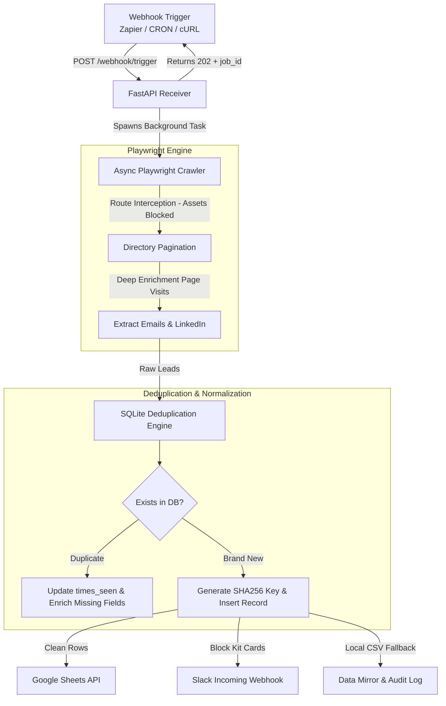

# 🏢 LeadPulse: Autonomous B2B Real Estate Lead Pipeline

[](https://www.python.org/)
[](https://playwright.dev/)
[](https://fastapi.tiangolo.com/)
[](https://www.docker.com/)
[](LICENSE)

An enterprise-ready, webhook-triggered scraping, deduplication, and synchronization pipeline built with **Python**, **Async Playwright**, **FastAPI**, **Google Sheets API**, **Slack Webhooks**, and **Docker**.

---

## 🎯 The High-Pain Target: Commercial Real Estate Agency Discovery

### Why It's High Pain
Real estate tech companies, mortgage lenders, property management software vendors, and marketing agencies constantly need **newly listed real estate agencies and commercial brokerages**. A single verified broker lead is valued at **$50 to $300**.

However, public directories and broker listings are notorious for:
1. **Messy & Fragmented Data:** Phone numbers in erratic formats, missing emails, dirty UTM parameters.
2. **Duplicate Waste:** The same agency listed 3–5 times across categories or branches, causing salespeople to double-contact brokers and burn company reputation.
3. **Hidden Contacts:** Emails are rarely displayed on directory cards; scrapers must visit agency websites, navigate `/contact` or `/about` pages, and locate `mailto:` tags.

### What LeadPulse Solves
LeadPulse automates this entire pipeline from end to end:
* **Webhook-Triggered Async Playwright:** Receives a webhook trigger (from Zapier, Make, CRON, or internal CRM) and spins up headless Chromium with stealth flags and **asset route-blocking** (blocking images, fonts, and stylesheets for a 5x speedup).
* **Deep Contact Enrichment:** Automatically visits each agency's website/profile to extract contact emails and LinkedIn profiles.
* **Intelligent Multi-Factor Deduplication:** Normalizes domains, cleans phone numbers to standard formats, strips corporate suffixes ("LLC", "Inc"), and maintains a persistent SQLite WAL database. Duplicates are filtered out, and existing records are enriched with new contact data.
* **Google Sheets API:** Formats and batch-appends clean rows directly to Google Sheets with styled headers, plus writes a local live mirror CSV.
* **Slack Webhooks:** Dispatches rich Slack **Block Kit** cards with company details, phone, email, ratings, and clickable website/LinkedIn buttons.

---

## 🏗️ Architecture



---

## 📂 Project Structure

```
(DEMOS)/
├── app/
│   ├── __init__.py
│   ├── config.py                 # Pydantic Settings & environment loader
│   ├── models.py                 # Pydantic schemas (Lead, Job, Stats, Webhook)
│   ├── deduper.py                # SQLite persistent deduplication engine
│   ├── scraper.py                # Async Playwright crawler & enrichment engine
│   ├── mock_server.py            # Built-in realistic mock directory server
│   ├── main.py                   # FastAPI application & webhook endpoints
│   └── integrations/
│       ├── __init__.py
│       ├── google_sheets.py      # Google Sheets API client + local CSV mirror
│       └── slack.py              # Slack Webhook Block Kit notification dispatcher
├── data/                         # Persistent database, CSV mirror, and logs
├── scripts/
│   ├── run_demo.py               # Complete one-command end-to-end CLI demo
│   └── trigger_webhook.sh        # cURL webhook testing script
├── tests/
│   ├── __init__.py
│   ├── test_deduper.py           # Deduplication & normalization unit tests
│   ├── test_api.py               # FastAPI endpoints & webhook tests
│   └── test_scraper.py           # Playwright scraper & mock directory tests
├── Dockerfile                    # Production Playwright container
├── docker-compose.yml            # Container orchestration with volume mounts
├── requirements.txt              # Production Python dependencies
├── .env.example                  # Environment configuration template
└── README.md                     # Documentation
```

---

## 🚀 Quickstart

### 1. Local Setup

```bash
# Navigate to the project directory
cd ~/Desktop/\(DEMOS\)

# Activate virtual environment
source .venv/bin/activate

# Install dependencies (if not already installed)
pip install -r requirements.txt
playwright install chromium
```

### 2. Run the One-Command Demo

Run the automated end-to-end demonstration. This starts an internal test server, scrapes 2 pages with Async Playwright, dedupes the listings (catching intentional duplicates), and pushes the clean records to Google Sheets and Slack:

```bash
python scripts/run_demo.py
```

**Sample Output:**
```
================================================================================
 🚀 LeadPulse: Autonomous Real Estate Lead Scraping & Deduplication Pipeline
================================================================================
Target: Commercial Real Estate Agencies & Brokerages in Austin, TX
Engine: Async Playwright (Chromium) with Route Interception (5x speed)
Storage: SQLite with Canonical Multi-Factor Hashing (WAL Mode)
Sinks: Google Sheets API + Slack Block Kit Webhook
--------------------------------------------------------------------------------

[Step 1/5] Launching Async Playwright Browser...
  ✓ Browser crawl finished in 2.14s
  ✓ Discovered 8 raw agency listings from target directory

[Step 2/5] Running Multi-Factor Deduplication & Enrichment Engine...
  [+] NEW LEAD: Apex Commercial Realty Partners     | Domain: apexcommercialrealty.com
  [+] NEW LEAD: Lone Star Property Advisors LLC     | Domain: lonestarpropadvisors.com
  [+] NEW LEAD: Silicon Hills Tenant Representation | Domain: siliconhillstenantrep.com
  [+] NEW LEAD: Capitol Metro Land Group            | Domain: capitolmetroland.com
  [+] NEW LEAD: Barton Springs Commercial Investmen | Domain: bartonspringscapital.com
  [♻️] DUPLICATE: Apex Commercial Realty (Downtown   | Domain: apexcommercialrealty.com (Seen 2x)
  [+] NEW LEAD: Highland Urban Real Estate Partners | Domain: highlandurbanpartners.com
  [♻️] DUPLICATE: Lone Star Property Advisors        | Domain: lonestarpropadvisors.com (Seen 2x)

  Summary: 6 Unique New Leads | 2 Duplicates Filtered

[Step 3/5] Pushing Clean Leads to Google Sheets API...
  ✓ Local Mirror (data/google_sheets_live_mirror.csv): Synced 6 rows

[Step 4/5] Dispatching Slack Block Kit Notifications...
  ✓ Dispatched Slack notifications and pipeline summary

[Step 5/5] Final Pipeline Metrics & Clean Lead Table:
================================================================================
ID   | Business Name                    | Phone            | Email                    
--------------------------------------------------------------------------------
1    | Apex Commercial Realty Partners  | (512) 555-0142   | contact@apexcommercialrealty.com
2    | Lone Star Property Advisors LLC  | (512) 555-0188   | info@lonestarpropadvisors.com
3    | Silicon Hills Tenant Representat | (512) 555-0199   | brokers@siliconhillstenantrep.com
4    | Capitol Metro Land Group         | (512) 555-0177   | deals@capitolmetroland.com
5    | Barton Springs Commercial Invest | (512) 555-0233   | invest@bartonspringscapital.com
6    | Highland Urban Real Estate Partn | (512) 555-0311   | hello@highlandurbanpartners.com
================================================================================
📊 Total Stored Leads: 6
🌐 Unique Domains:     6
🛡️ Duplicates Blocked: 2
⚡ Deduplication Rate: 25.0%
⏱️ Total Execution:    4.38 seconds
================================================================================
✅ DEMO COMPLETED SUCCESSFULLY!
```

---

## 🌐 Running the FastAPI Webhook Server

Start the API server:
```bash
uvicorn app.main:app --host 0.0.0.0 --port 8000 --reload
```

Interactive API documentation will be available at:
* **Swagger UI:** [http://localhost:8000/docs](http://localhost:8000/docs)
* **ReDoc:** [http://localhost:8000/redoc](http://localhost:8000/redoc)
* **Mock Directory Sandbox:** [http://localhost:8000/mock-directory/search](http://localhost:8000/mock-directory/search)

---

## 📡 Webhook Trigger & Endpoints

### 1. Trigger an Autonomous Scrape Run (`POST /webhook/trigger`)
Can be triggered from Zapier, Make, CRON, or GitHub Actions:

```bash
curl -X POST "http://localhost:8000/webhook/trigger" \
  -H "Content-Type: application/json" \
  -d '{
    "target": "real_estate",
    "query": "Commercial Real Estate Agencies",
    "location": "Austin, TX",
    "max_pages": 2,
    "enrich_contacts": true,
    "sync_to_sheets": true,
    "notify_slack": true
  }'
```

**Response (HTTP 200 - Background Task Scheduled):**
```json
{
  "job_id": "9a38f72c1e89",
  "status": "queued",
  "created_at": "2026-11-22T03:00:00Z",
  "message": "Scrape job queued for 'Commercial Real Estate Agencies' in 'Austin, TX'.",
  "poll_url": "/jobs/9a38f72c1e89"
}
```

### 2. Poll Job Status (`GET /jobs/{job_id}`)
```bash
curl -X GET "http://localhost:8000/jobs/9a38f72c1e89"
```

### 3. Ingest Leads Directly (`POST /webhook/ingest`)
For syncing leads directly from forms or third-party webhooks:
```bash
curl -X POST "http://localhost:8000/webhook/ingest" \
  -H "Content-Type: application/json" \
  -d '{
    "name": "Hill Country Commercial Brokerage",
    "category": "Commercial Brokerage",
    "phone": "(512) 555-7744",
    "email": "partners@hillcountrybrokerage.com",
    "website": "https://www.hillcountrybrokerage.com",
    "city": "Austin",
    "state": "TX"
  }'
```

### 4. Fetch Stored Leads (`GET /leads`)
```bash
curl -X GET "http://localhost:8000/leads?limit=10&city=Austin"
```

### 5. Export Deduplicated CSV (`GET /leads/export/csv`)
```bash
curl -O "http://localhost:8000/leads/export/csv"
```

### 6. Pipeline Analytics (`GET /stats`)
```bash
curl -X GET "http://localhost:8000/stats"
```

---

## 🐳 Docker Deployment

The application includes a production-grade multi-stage Docker setup with Playwright pre-installed.

### Build and Run with Docker Compose
```bash
# Build and run container
docker compose up --build -d

# Check container health and logs
docker compose logs -f
```

The container automatically mounts `./data` as a persistent volume for the SQLite database and sync audit logs.

---

## ⚙️ Integrations Setup

### 1. Google Sheets API
1. Create a project in [Google Cloud Console](https://console.cloud.google.com/).
2. Enable the **Google Sheets API** and **Google Drive API**.
3. Create a **Service Account**, generate a JSON key, and save it as `service_account.json` in the project root.
4. Set in `.env`:
   ```env
   GOOGLE_SERVICE_ACCOUNT_FILE=service_account.json
   GOOGLE_SHEET_TITLE="B2B Real Estate Agencies - Clean Leads"
   ```
5. *(Safe Fallback)* If no credentials are provided, LeadPulse seamlessly appends all clean rows to `data/google_sheets_live_mirror.csv` for audit and inspection!

### 2. Slack Incoming Webhook
1. Go to [api.slack.com/apps](https://api.slack.com/apps) -> **Incoming Webhooks** -> **Activate Incoming Webhooks**.
2. Click **Add New Webhook to Workspace** and select your target channel (e.g. `#b2b-leads`).
3. Set in `.env`:
   ```env
   SLACK_WEBHOOK_URL="https://hooks.slack.com/services/T000/B000/XXXX"
   ```
4. *(Safe Fallback)* If no webhook is configured, LeadPulse formats the Block Kit payload and records it in `data/slack_notifications.log`.

---

## 🧪 Automated Tests

Run the full pytest suite:
```bash
pytest -v tests/
```

Tests cover:
* Canonical domain normalization (subdomains, ports, query stripping)
* Phone number normalization
* Multi-factor deduplication and field enrichment
* FastAPI webhook trigger and ingest endpoints
* Data integrity of directory targets

---

## 📄 License
MIT License. Created for high-performance B2B data workflows.
